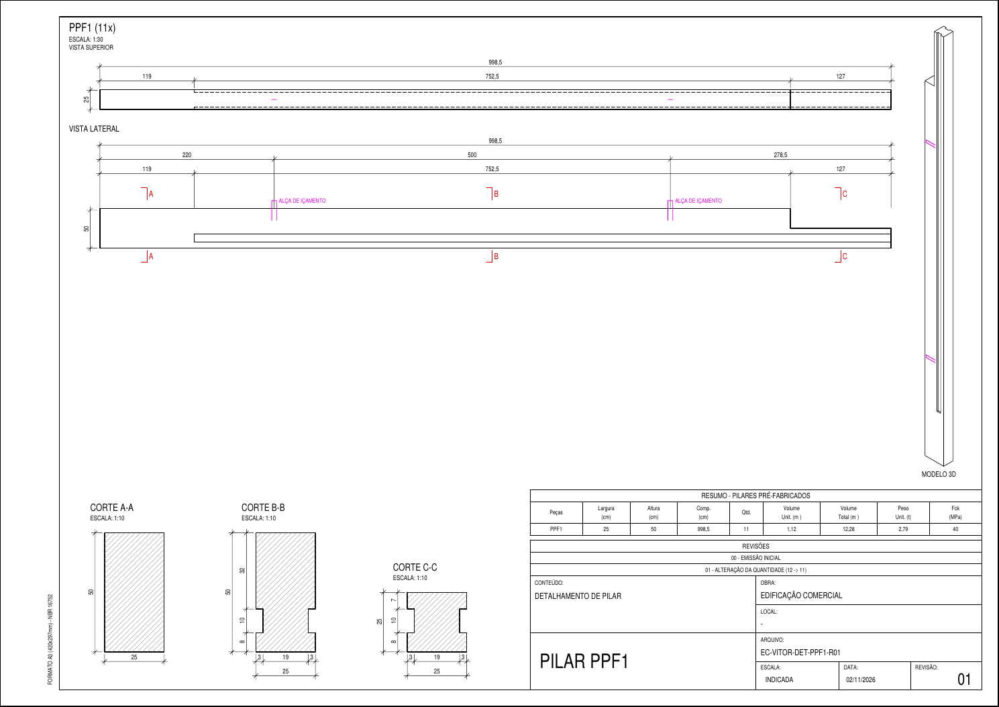

# Detalhamento Pré-moldado para SketchUp

Extensão para SketchUp que lê as peças de concreto pré-moldado de um modelo 3D
(pilares, vigas, placas, lajes, tesouras, blocos…) e gera automaticamente a
**prancha A3 de formas** de cada tipo de peça, em **PDF** (e DXF, se quiser).



## O que vai em cada prancha

- **Vista superior e vista lateral** em escala automática (1:20, 1:25, 1:30, 1:40…),
  com linhas ocultas tracejadas.
- **Cotas** em cm: parciais em cadeia e totais, além da posição dos insertos
  (alças de içamento, chapas etc.).
- **Cortes automáticos** (A-A, B-B, C-C…) nos trechos onde a seção da peça muda,
  com hachura e cotas, marcados na vista lateral.
- **Modelo 3D** isométrico.
- **Quadro resumo**: largura, altura, comprimento, quantidade, volume unitário e
  total (calculado pelo sólido real), peso e fck.
- **Revisões** e **carimbo**: conteúdo, nome da peça, obra, local, arquivo,
  escala, data e revisão.
- Folha A3 com margens da NBR 16752.

O nome dos arquivos segue o padrão `PREFIXO-OBRA-DET-PEÇA-Rxx`, por exemplo
`EC-VITOR-DET-PPF1-R01.pdf`.

## Instalação

1. Baixe o arquivo `.rbz` mais recente na página de
   [Releases](../../releases).
2. No SketchUp: **Extensões › Gerenciador de extensões › Instalar extensão** e
   escolha o `.rbz`.
3. Reinicie o SketchUp.

Testado para SketchUp 2021 ou mais recente (Ruby 2.7+). Não precisa de nenhum
outro programa ou biblioteca.

## Como usar

No menu **Extensões › Detalhamento Pré-moldado**:

| Comando | O que faz |
|---|---|
| Gerar pranchas A3 (todas as peças) | Gera uma prancha para cada tipo de peça do modelo |
| Gerar prancha das peças selecionadas | Só para a seleção (também no botão direito do mouse) |
| Exportar lista de peças (CSV) | Planilha com peça, tipo, tag, quantidade, medidas, volume e peso |

Ao gerar, abre uma janela de configuração. Os valores ficam salvos para a
próxima vez:

| Campo | Exemplo |
|---|---|
| Formato de saída | PDF por peça · PDF único · PDF e DXF · DXF |
| Tags a detalhar | `Bloco,Pilares,Consoles,Placas,Vigas,Lajes,Tesouras` |
| Palavras que identificam insertos | `insert,neoprene,alça,chapa,içamento` |
| Obra / Local | `EDIFICAÇÃO COMERCIAL` |
| Prefixo do arquivo / Código da obra | `EC` / `VITOR` |
| Revisão atual / Histórico | `01` / `00 - EMISSÃO INICIAL; 01 - ALTERAÇÃO…` |
| Data | vazio = hoje |
| Fck (MPa) / Peso específico (t/m³) | `40` / `2,5` |
| Fonte do texto no DXF | `romans.shx` |

## Como o modelo deve estar organizado

- Cada peça é um **componente** ou **grupo**. O nome do componente é o nome da
  peça na prancha (por exemplo `PPF1`).
- Peças **iguais** (mesmo nome e mesmas medidas) viram uma prancha só, com a
  quantidade contada.
- A **tag** da peça define se ela entra (filtro de tags) e o tipo
  (Pilar, Viga, Placa…).
- Componentes dentro da peça cujo nome ou tag contenha uma das palavras de
  insertos (alça, chapa, neoprene…) são desenhados como **insertos**, em cor
  separada, e não entram no volume nem nos cortes.
- O desenho usa os **eixos do próprio componente**: o eixo mais comprido vira o
  comprimento da prancha.

## Limitações conhecidas

- **Armadura** (posições N1, N2…, resumo de aço) ainda não é gerada.
- Superfícies curvas suavizadas aparecem só pelas arestas visíveis.
- As cotas no DXF são linhas e textos, não cotas associativas do AutoCAD.
- Os cortes são escolhidos automaticamente (até 4 por peça).

> ⚠️ A extensão automatiza o desenho a partir do modelo. As pranchas devem ser
> conferidas e assinadas pelo engenheiro responsável antes de ir para a fábrica.

## Estrutura do projeto

```
src/
  detalhamento_pm.rb          carregador da extensão (versão fica aqui)
  detalhamento_pm/
    main.rb                   integração com o SketchUp: menus, janela, leitura das peças
    prancha.rb                montagem da prancha A3 (vistas, cortes, cotas, carimbo)
    geom.rb                   geometria: projeções, linhas ocultas, cortes, hachura, volume
    pdf.rb                    gravador de PDF vetorial
    dxf.rb                    gravador de DXF R12
test/                         testes que rodam fora do SketchUp (API simulada)
tools/build.rb                gera dist/detalhamento_pm-<versão>.rbz
tools/visualizar_dxf.py       gera PNG de um DXF para conferência (opcional)
```

`geom.rb`, `prancha.rb`, `pdf.rb` e `dxf.rb` são Ruby puro: não dependem do
SketchUp e podem ser testados em qualquer computador.

## Desenvolvimento

```bash
ruby test/executar_todos.rb   # roda os testes (gera exemplos em test/saida/)
ruby tools/build.rb           # empacota o .rbz em dist/
```

### Publicando uma nova versão

1. Altere `ext.version` em `src/detalhamento_pm.rb`.
2. Registre as mudanças no `CHANGELOG.md`.
3. Faça o commit e crie a tag:
   ```bash
   git tag v0.4.0
   git push origin main --tags
   ```
4. O GitHub Actions roda os testes (Ruby 2.7 e 3.2), empacota o `.rbz` e cria a
   release automaticamente.

## Autor

[MarcoAntonioMartins](https://github.com/MarcoAntonioMartins)

## Licença

[MIT](LICENSE). Use, modifique e distribua livremente, mantendo o aviso de
copyright.
